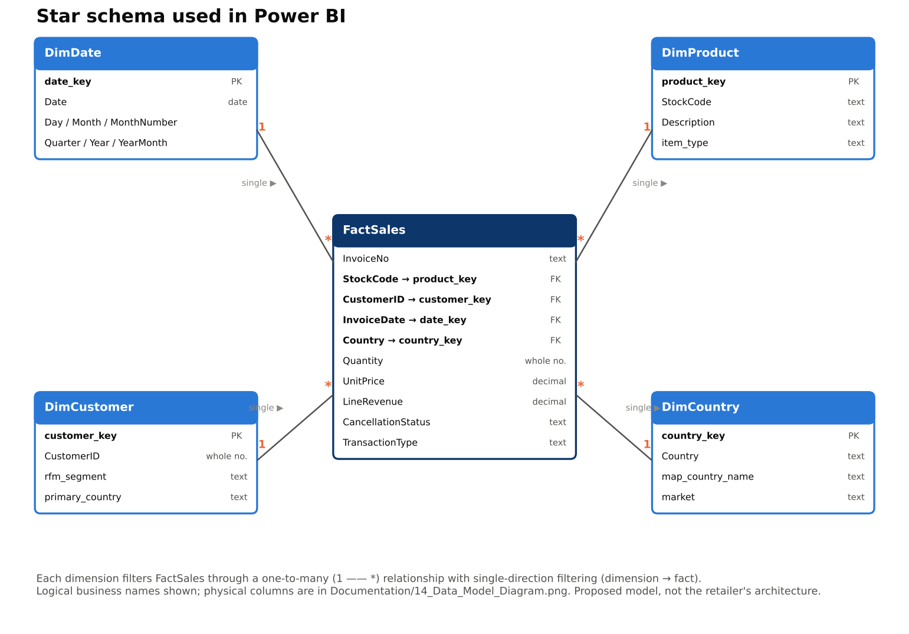
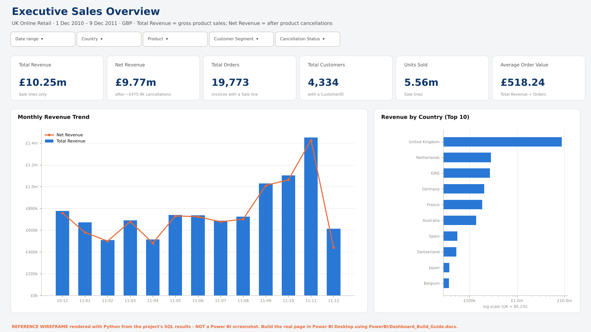

# UK Online Retail Sales & Customer Analytics

**End-to-end business intelligence portfolio project** on 541,909 real transactions from a UK online giftware retailer - PostgreSQL star schema, documented data cleaning, automated validation, 33 SQL analyses, RFM customer segmentation and a five-page Power BI dashboard design.

`PostgreSQL` · `SQL` · `Python / pandas` · `Power Query (M)` · `DAX` · `Power BI` · `Data modelling` · `Data quality`

> Independent portfolio project using a public dataset. It is not an engagement with, or endorsed by, the retailer. New here? Start with **[START_HERE.md](START_HERE.md)**. What is tested and what is not: **[PROJECT_STATUS.md](PROJECT_STATUS.md)**.

---

## Project overview

The [UCI Online Retail dataset](https://archive.ics.uci.edu/dataset/352/online+retail) records every invoice line of a UK-based, non-store online retailer of all-occasion gifts between **1 December 2010 and 9 December 2011**. Many customers are wholesalers. The raw data contains cancellations, negative quantities, duplicates, service codes and 25% of lines without a customer ID - realistic problems that must be handled before any number can be trusted.

This project takes the data from the official file to business recommendations:

```
Official xlsx ─► raw table (unchanged) ─► cleaned & classified ─► star schema ─► SQL analysis + RFM ─► Power BI ─► insights
     │                541,909 rows          536,641 rows          1 fact + 4 dims    33 queries           5 pages
     └── SHA-256 recorded          32 automated checks · SQL = Python (byte-identical) · full rebuild test
```

## Business problem

Managers need one reconciled view of **where revenue comes from**, **which products, countries and customers matter**, **how much is lost to cancellations** and **whether customers return**, with transparent rules for cancellations, returns and missing customer IDs. Fourteen business questions are listed in `Documentation/02_Business_Requirements.docx`.

## Dataset source

Chen, D. (2015). *Online Retail* [Dataset]. UCI Machine Learning Repository. https://doi.org/10.24432/C5BW33 - licensed **CC BY 4.0**. Details: [Dataset/source_information.md](Dataset/source_information.md).

## Tools and technologies

| Tool | Use | Status |
|---|---|---|
| PostgreSQL (written for 18, tested on 16.15) | Raw landing, cleaning, star schema, analysis, RFM | Executed by author |
| pgAdmin 4 | Database creation, import, running scripts | Instructions |
| Python 3, pandas | xlsx→csv conversion, independent cleaning and KPI/RFM parity checks | Executed by author |
| Power BI Desktop - Power Query, DAX | Model, 27 measures, five-page dashboard | Generated; build locally |
| Matplotlib | Charts, ER diagrams, dashboard wireframes | Executed by author |

## Objectives

Data acquisition · profiling · cleaning · validation · PostgreSQL development · SQL analysis · data modelling · Power Query · DAX · dashboard design · customer segmentation · insight generation · data storytelling.

## Data cleaning methodology

Eleven documented rules (R1-R11). The principle is **flag, don't delete**: every source line except exact duplicates is kept and given one `transaction_type`.

| Issue | Lines | Treatment |
|---|---:|---|
| Exact duplicate lines | 5,268 | Later copies excluded (first occurrence kept) |
| Cancellations (`InvoiceNo` starts with C) | 9,288 | Kept, labelled; used for Net Revenue |
| Negative quantity, non-cancellation | 1,336 | £0 stock write-offs → *Stock Adjustment* |
| Missing CustomerID | 135,080 | Kept; mapped to an "Unknown" member; excluded only from customer metrics |
| Service codes (POST, M, D, AMAZONFEE…) | 2,946 | *Non-Product*; excluded from product rankings |
| Zero / negative price | 2,515 / 2 | Kept, labelled; no revenue |

**Revenue definitions** - *Total Revenue* = Sale lines (£10,247,219.32) · *Net Revenue* = Total Revenue + merchandise cancellations (£9,771,318.16). Full detail: `Documentation/06_Data_Cleaning_Methodology.docx`.

## SQL analysis

`SQL/15_SQL_Analysis_Queries.sql` - 33 queries in six groups (revenue, product, customer, order, geography, advanced), each with business question, explanation, output columns, relevance and learning objective. Techniques: INNER/LEFT JOIN, anti-join, GROUP BY + `FILTER`, HAVING, CASE, subqueries, CTEs, `RANK`, `DENSE_RANK`, `ROW_NUMBER`, `LAG`, running totals, `NTILE`, `CUME_DIST`, `PERCENTILE_CONT`. All were executed; reference outputs are in `Analysis_Outputs/sql_results/`.

## Data modelling



Star schema in schema `dw` at **invoice-line grain**: `fact_sales` (536,641) with `dim_date` (730), `dim_product` (3,958), `dim_customer` (4,373 incl. Unknown member) and `dim_country` (38). Surrogate keys, foreign-key and CHECK constraints, indexes. Proposed analytical model - not the retailer's internal architecture.

## Power BI dashboard

Five pages: **Executive Overview · Product Performance · Geographical Performance · Customer Analytics (RFM) · Sales Trends & Cancellations**, with synced slicers for Date, Country, Product, Customer Segment and Cancellation Status.



*Reference wireframe rendered with Python from the SQL results - **not a Power BI screenshot**. The PBIX is built locally from `PowerBI/Dashboard_Build_Guide.docx`; genuine screenshots go in `PowerBI/Screenshots/`.*

## Key findings

| # | Finding | Evidence |
|---|---|---|
| 1 | Revenue is concentrated in the UK | 85.1% of Total Revenue; 90.5% of orders |
| 2 | Strong autumn peak | Sep-Nov 2011 = 35.0% of revenue; Nov 2011 £1.45m, 2.2× the Jan-Aug monthly average |
| 3 | Long product tail | 831 products (21.9%) deliver 80% of net revenue; top 10 only 8.2% |
| 4 | Repeat customers drive revenue | 65.3% repeat rate; one-order customers = 34.7% of customers but 7.2% of revenue |
| 5 | Customer value is skewed | Top 1% of customers = 30.2% of identified net revenue; median spend £663 vs mean £2,016 |
| 6 | RFM: Champions dominate | 28.4% of customers, 70.5% of net revenue; 877 *At Risk* customers hold 12.2% |
| 7 | Cancellations | 16.2% of invoices; two orders cancelled within minutes = 51.6% of cancelled product value |
| 8 | Data gap | 14.7% of revenue (£1.51m) has no CustomerID |

All 14 insights with evidence, interpretation, actions and limitations: `Documentation/28_Business_Insights_Report.docx`.

## Recommendations

1. Plan stock, staffing and campaigns for September-November.
2. Retention programme: re-order reminders around the 22-day median gap; win-back test for *At Risk* customers.
3. Key-account management for the largest UK and international customers.
4. Order-entry check for very large quantities and cancellation reason codes.
5. Capture a customer identifier on every order.
6. Review the long product tail once margin data is available.

## Limitations

No cost/margin/inventory data (profit is out of scope) · 13 months only (seasonality observed once; like-for-like YoY only for 1-9 December) · 25% of lines lack a CustomerID · cancellations cannot be linked to their original orders · findings are descriptive, not causal.

## Reproduction instructions

Full step-by-step guide for Windows + PostgreSQL 18 + pgAdmin 4 + Power BI: **[START_HERE.md](START_HERE.md)**. In short:

1. Create database `online_retail_bi`; run `SQL/10_Database_Schema.sql`.
2. Import `Dataset/raw/online_retail_raw.csv` into `staging.raw_online_retail` (or download from UCI - see `Dataset/download_instructions.md`).
3. Run `11` → `07` → `08` → `13` → `15` → `17` (or `SQL/run_all_psql.sql` in the PSQL Tool).
4. Build the Power BI model with `PowerBI/21_Power_Query_M_Code.txt` and `PowerBI/24_DAX_Measures.md`.

## Repository structure

```
UK-Online-Retail-Business-Intelligence/
├── README.md · START_HERE.md · PROJECT_STATUS.md · .gitignore
├── Dataset/        source_information.md, download_instructions.md, checksums.txt,
│                   03_Dataset_Profile.xlsx, 04_Data_Dictionary.xlsx,
│                   raw/online_retail_raw.csv*, cleaned/09_Cleaned_Online_Retail.csv*
├── SQL/            10_Database_Schema, 11_Table_Creation, 07_Data_Cleaning_Script,
│                   08_Data_Validation_Script, 13_Database_Validation,
│                   15_SQL_Analysis_Queries, 17_RFM_Analysis, run_all_psql (.sql),
│                   12_Data_Import_Instructions.md
├── Python/         convert_xlsx_to_csv.py, clean_online_retail.py, verify_kpis_and_rfm.py
├── Analysis_Outputs/  sql_results/Q01-Q33.csv, 18_RFM_Customer_Segmentation.xlsx, charts/
├── PowerBI/        21_Power_Query_M_Code.txt, 24_DAX_Measures.md, Dashboard_Build_Guide.docx,
│                   UK_Retail_Theme.json, Wireframes/, Screenshots/, (dashboard.pbix - you build it)
├── Documentation/  01, 02, 05, 06, 16, 19, 20, 22, 25, 28 (.docx), 14 & 23 diagrams (.png)
├── Testing/        26_Data_Validation_Test_Cases.xlsx, 27_Testing_Report.docx
├── Presentation/   29_Executive_Presentation.pptx
├── Career/         30_CV, 31_LinkedIn, 32_Interview_Preparation (.docx)
└── Learning/       33_Learning_Guide.docx
* included in the ZIP, excluded from Git by .gitignore (file size)
```

File names use the deliverable numbers from the project brief. Mapping to the suggested GitHub names: `database_schema.sql` = 10 + 11, `data_cleaning.sql` = 07, `data_validation.sql` = 08 + 13, `analysis_queries.sql` = 15, `rfm_analysis.sql` = 17, `data_dictionary.xlsx` = 04, `dax_measures.md` = 24, `power_query_m_code.txt` = 21.

## Dataset attribution and licence

Data: Chen, D. (2015). *Online Retail*. UCI Machine Learning Repository. https://doi.org/10.24432/C5BW33. Licensed under [CC BY 4.0](https://creativecommons.org/licenses/by/4.0/). The cleaned CSV is a derivative work; changes are documented in `Documentation/06_Data_Cleaning_Methodology.docx`. Project code and documentation: add the licence of your choice (e.g. MIT) before publishing.


## Database Configuration

| Setting | Value |
|---|---|
| Database Name | online_retail_bi |
| Database Engine | PostgreSQL |
| Tested Version | PostgreSQL 18 |
| Host | localhost |
| Port | 5432 |

Note: These are local development settings.
Users must configure their own PostgreSQL connection.
No database passwords or credentials are included.